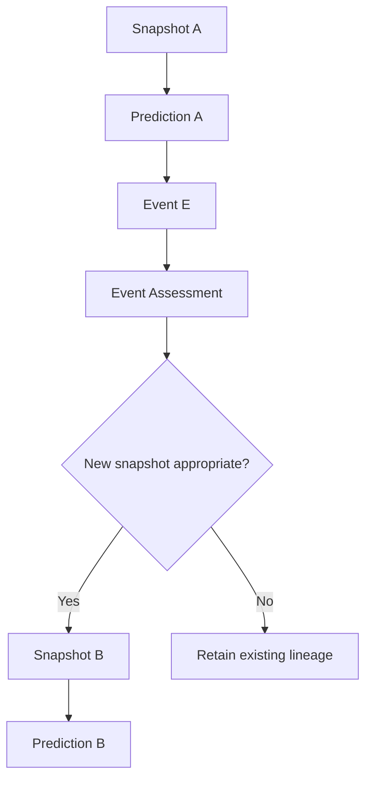

# Conceptual interface contracts

Status: **DESIGNED — not implemented or tested.**

These are approved conceptual minimums, not finalized schemas, API signatures, database tables, or code. Labels without explicit identifiers retain the owner's conceptual wording. Data types, serialization, lifecycle enums, enforcement mechanisms, and detailed relationships remain unspecified. Do not infer implementation from these tables.

## Task

| Field / concept | Architectural meaning |
|---|---|
| task_id | Task identifier |
| domain_id | Domain identifier |
| task_type | Task type |
| created_at | Creation time |
| input_snapshot_id | Reference to input snapshot |
| dependencies | Task dependencies |
| Permitted workers/models allowlist or execution-policy reference | Execution eligibility; not permanent binding to one worker/model |
| Expected output contract | Required output shape/contract |
| Validation requirements | Requirements for separate validation |
| Evidence requirements | Required evidence |
| Cost/resource ceiling | Resource constraint |
| Lifecycle state | Task state; values not yet specified |

## Snapshot

A Snapshot represents what Ripley knew when a prediction or decision was made. Once used for that purpose, it becomes an immutable historical record.

| Field / concept | Architectural meaning |
|---|---|
| snapshot_id | Snapshot identifier |
| domain_id | Domain identifier |
| Observation time | Time represented by the observation |
| Evidence/source references | Provenance references |
| Normalized inputs | Inputs known at that point |
| Data-quality status | Recorded input quality status |
| Domain state/version | Referenced domain state/version |
| parent_snapshot_id, when applicable | Lineage reference |

Immutability does not imply factual infallibility. Later corrections preserve the original and use correction/supersession mechanisms.

## Event: factual observation

| Field / concept | Architectural meaning |
|---|---|
| event_id | Event identifier |
| domain_id | Domain identifier |
| Observed occurrence | What was observed |
| Event/observation time | Time of event or observation |
| Detection time, where applicable | Time of detection |
| Source/evidence | Observation provenance |
| Factual event payload | Factual event content |

Materiality judgments must not be embedded into the factual Event record.

## Event Assessment: interpretation

| Field / concept | Architectural meaning |
|---|---|
| assessment_id | Assessment identifier |
| event_id | Referenced factual event |
| Assessor/version | Attribution and version |
| Materiality determination | Judgment about materiality |
| Affected-state interpretation | Interpretation of state impact |
| Reasoning/evidence | Support for the judgment |
| Assessment time | Time assessment was made |
| supersedes_prior_assessment, when applicable | Reference to superseded judgment |

Interpretations can change without rewriting the event.

### Event lineage

The diagram expresses conceptual lineage, not a finalized control algorithm. Original Snapshot A and Prediction A remain preserved in either case. Event assessment does not itself authorize production modification.

## Result

A Worker produces a Result but does not have authority to independently validate its own Result.

| Field / concept | Architectural meaning |
|---|---|
| task_id | Associated task |
| result_id | Result identifier |
| Worker/model identity | Producer attribution |
| input_snapshot_id | Referenced input snapshot |
| Structured output | Produced output |
| Supporting evidence | Output evidence |
| Worker warnings/limitations | Producer disclosures |
| Execution metadata | Execution context |
| Cost/usage record, where applicable | Resource usage |

## Validation

Validation is a separate record, produced by the validation process, that references **result_id**.

Result means what was produced. Validation means what an independent validation process determined about it. The approved handoff does not yet define the full Validation field set or independence enforcement mechanism. Worker warnings, self-checks, or confidence do not substitute for independent validation authority.

## Outcome, Grade, and Classification

| Concept | Record treatment | Meaning |
|---|---|---|
| Prediction | Frozen historical prediction | Preserved basis for comparison |
| Outcome | Factual | Recorded actual outcome |
| Grade | Factual | Mechanically determinable comparison of frozen prediction and recorded outcome |
| Classification | Interpretive and revisable | Evidence-based explanation, potentially requiring accumulated outcomes |

Full field sets for these records are not specified in this handoff. Domain-specific grading rules stay outside Core. Incorrect factual records, including records used in grading, require correction/supersession with historical preservation; interpretations are separately revisable.

## Review and Decision

Review and Decision appear in the approved provenance chain, with Review/Correction and Approval in the MVP flow. Their complete contracts, approval roles, and enforcement details are not defined by this handoff. No missing schema or authority model is invented here.
